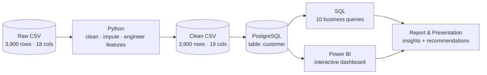
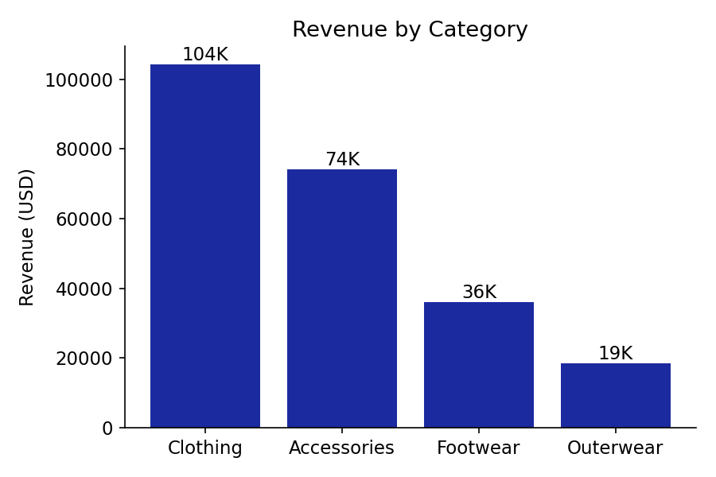
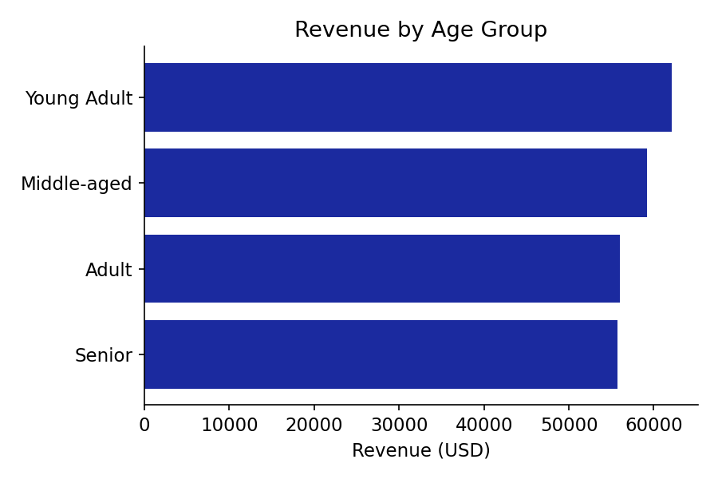
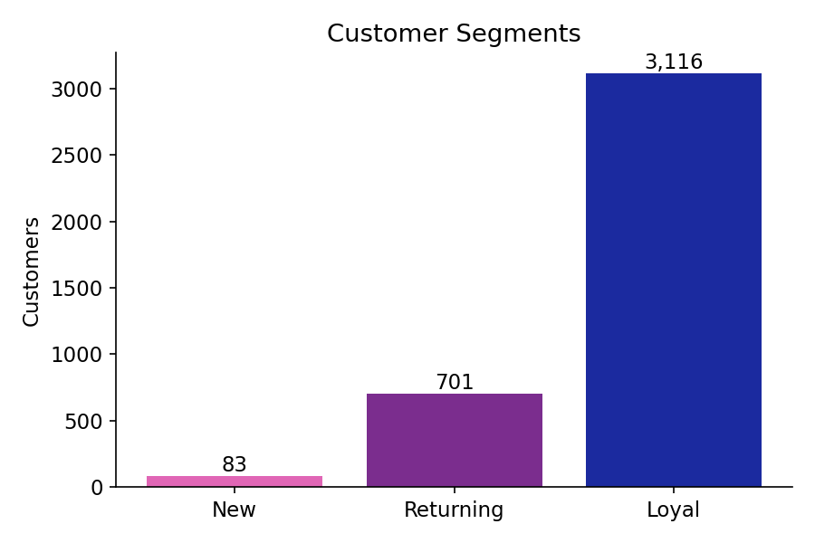
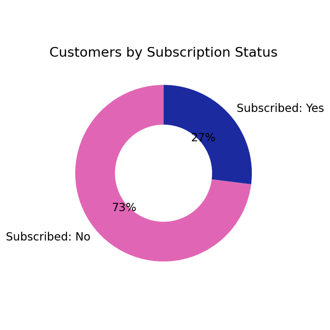
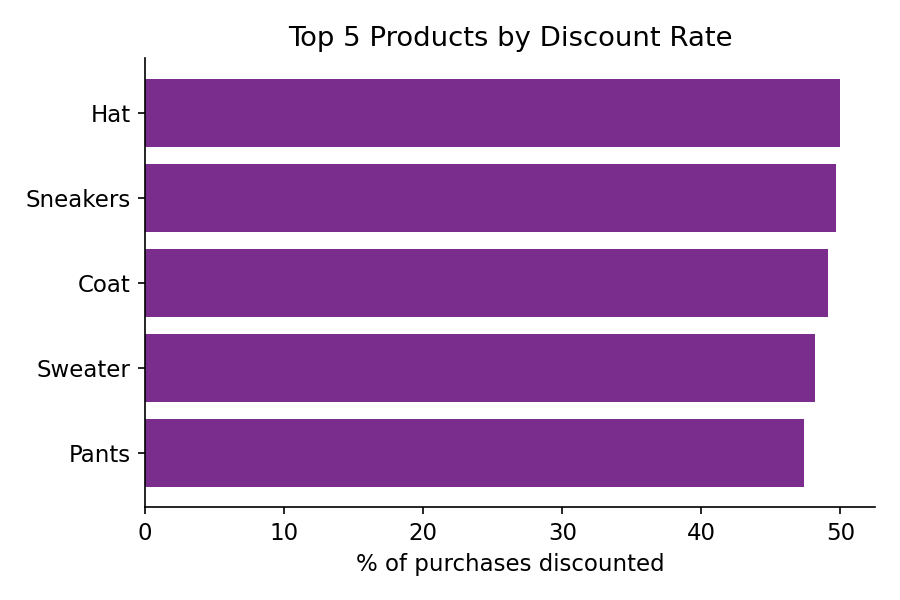

# 🛍️ Customer Shopping Behavior Analysis

An end-to-end data analytics project that turns 3,900 retail transactions into business insights using **Python, PostgreSQL and Power BI**.

> **Business question:** *How can the company leverage consumer shopping data to identify trends, improve customer engagement, and optimize marketing and product strategies?* (see [`docs/Business_Problem_Statement.pdf`](docs/Business_Problem_Statement.pdf))

## 🔄 Project Workflow



## 🧰 Tech Stack

| Stage | Tools |
|---|---|
| Data preparation & EDA | Python, pandas, matplotlib, seaborn, Jupyter |
| Data analysis | PostgreSQL (also works on MySQL / SQL Server with small syntax changes), SQLAlchemy |
| Visualization | Power BI |
| Reporting | PDF report, PowerPoint deck |

## 📂 Repository Structure

```
customer-shopping-behavior-analysis/
├── data/
│   ├── raw/                  # original dataset
│   └── processed/            # cleaned dataset (output of the cleaning step)
├── notebooks/
│   └── Customer_Shopping_Behavior_Analysis.ipynb   # EDA, cleaning, feature engineering
├── scripts/
│   ├── clean_data.py         # reproducible cleaning pipeline
│   ├── load_to_db.py         # loads cleaned data into PostgreSQL
│   └── generate_charts.py    # builds the charts in /images
├── sql/
│   └── customer_behavior_sql_queries.sql           # 10 business questions
├── dashboard/
│   └── customer_behavior_dashboard.pbix            # Power BI dashboard
├── docs/                     # report, presentation, business problem statement
├── images/                   # charts used in this README
├── .env.example              # database credentials template
├── requirements.txt
└── LICENSE
```

## 📊 Dataset

3,900 purchases, 18 original columns: customer demographics (age, gender, location, subscription status), purchase details (item, category, amount, season, size, color), and behavior (discount applied, promo code, previous purchases, purchase frequency, review rating, shipping type, payment method). 37 `Review Rating` values were missing.

## 🧹 Data Preparation (Python)

1. Imputed missing `Review Rating` values with the **median rating of each product category**
2. Renamed columns to `snake_case` (`Purchase Amount (USD)` → `purchase_amount`)
3. Engineered **`age_group`** (quartile bins: Young Adult, Adult, Middle-aged, Senior)
4. Engineered **`purchase_frequency_days`** (e.g. Weekly → 7, Quarterly → 90)
5. Dropped `promo_code_used` after confirming it is identical to `discount_applied`
6. Loaded the cleaned table into PostgreSQL

## 🗃️ SQL Analysis

All 10 queries live in [`sql/customer_behavior_sql_queries.sql`](sql/customer_behavior_sql_queries.sql).

| # | Question | Key result |
|---|---|---|
| 1 | Revenue by gender | Male $157,890 vs Female $75,191 |
| 2 | Discount users who still spent above average | 839 customers |
| 3 | Top 5 products by average rating | Gloves (3.86), Sandals, Boots, Hat, Skirt |
| 4 | Standard vs Express shipping | Express $60.48 vs Standard $58.46 average spend |
| 5 | Subscribers vs non-subscribers | Avg spend almost identical ($59.49 vs $59.87) |
| 6 | Most discount-dependent products | Hat 50.00%, Sneakers 49.66%, Coat 49.07% |
| 7 | New / Returning / Loyal segments | Loyal 3,116 · Returning 701 · New 83 |
| 8 | Top 3 products per category | Jewelry, Blouse, Sandals, Jacket lead their categories |
| 9 | Repeat buyers vs subscription | 958 subscribed vs 2,518 not subscribed |
| 10 | Revenue by age group | Young Adult $62,143 highest; Senior $55,763 lowest |

## 📈 Dashboard & Charts

The interactive Power BI dashboard is in [`dashboard/`](dashboard/) (open with Power BI Desktop). It shows total customers (3.9K), average purchase amount ($59.76), average review rating (3.75), plus revenue and sales by category and age group, with filters for subscription status, gender, category and shipping type.

| | |
|---|---|
|  |  |
|  |  |
|  | |

## 💡 Key Insights

- **Clothing and Accessories drive most revenue**; Outerwear contributes the least.
- **Only 27% of customers are subscribers**, and they do not spend more per order than non-subscribers.
- **80% of customers are already "Loyal"** (more than 10 previous purchases), so the base is retained but the subscription program is under-used.
- **Discounts are applied to roughly half of purchases** for the most discounted products, which may erode margin.
- **Young Adults generate the most revenue**, though the spread across age groups is narrow.

## ✅ Business Recommendations

- **Boost subscriptions:** promote exclusive benefits so loyal buyers have a reason to subscribe.
- **Loyalty programs:** reward repeat buyers and move "Returning" customers into "Loyal".
- **Review discount policy:** balance sales boosts against margin.
- **Product positioning:** feature top-rated and best-selling products in campaigns.
- **Targeted marketing:** focus on high-revenue age groups and express-shipping users.

## 🚀 How to Run

```bash
# 1. Clone and install
git clone https://github.com/aasthabansod9-arch/customer-shopping-behavior-analysis.git
cd customer-shopping-behavior-analysis
pip install -r requirements.txt

# 2. Clean the data (creates data/processed/...clean.csv)
python scripts/clean_data.py

# 3. (Optional) Load into PostgreSQL
cp .env.example .env        # add your own database credentials
python scripts/load_to_db.py

# 4. Run the SQL queries in sql/customer_behavior_sql_queries.sql
# 5. Open dashboard/customer_behavior_dashboard.pbix in Power BI Desktop
```

You can also explore step by step in `notebooks/Customer_Shopping_Behavior_Analysis.ipynb`.

## 🙏 Acknowledgements

This project follows the portfolio-project structure and dataset from [Amlan Mohanty's tutorial](https://www.youtube.com/watch?v=5PrZvPeUw60) (original repo: `amlanmohanty1/customer-trends-data-analysis-SQL-Python-PowerBI`), released under the MIT license. This version adds a reproducible Python pipeline, credential handling via `.env`, validated SQL, and a restructured repository.

## 📜 License

MIT, see [`LICENSE`](LICENSE).

## 👩‍💻 Author

**Aastha**: B.Tech CSE student, Pune, India, building toward a career in data analytics and AI/ML.
🔗 [LinkedIn](https://www.linkedin.com/in/aastha-bansod-6a3066371) · 💻 [GitHub](https://github.com/aasthabansod9-arch)
